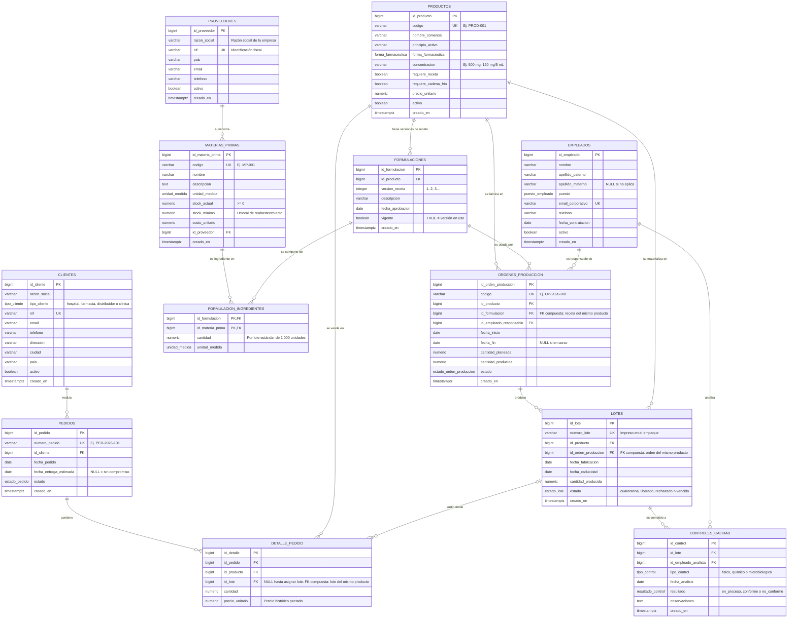

# LabioFarm · Base de datos PostgreSQL

**Sistema de Gestión de Producción y Control de Calidad de un laboratorio biofarmacéutico.**

Modelo relacional profesional con 12 tablas en 3FN, 7 vistas, 4 funciones, 1 vista
materializada, 9 tipos enumerados y 15 índices (incluyendo índices parciales).
Todo el código está comentado en español y fue **probado contra un servidor
PostgreSQL real** (scripts, consultas, restricciones e idempotencia).

---

## Contenido del repositorio

```
labiofarm/
├── README.md                       <- Esta guía (diagrama ER + montaje)
└── sql/
    ├── 01_crear_base_datos.sql     <- Crea la base "labiofarm" (ejecutar UNA VEZ)
    ├── 02_crear_esquema.sql        <- Esquema biofarm: tipos, 12 tablas, índices, comentarios
    ├── 03_crear_consultas.sql      <- 7 vistas + 4 funciones + 1 vista materializada
    ├── 04_datos_prueba.sql         <- OPCIONAL: datos ficticios para probar consultas
    └── 05_verificacion.sql         <- Verifica estructura y hace pruebas de humo
```

**Orden de ejecución (obligatorio, por dependencias):**

```
01 → 02 → 03 → (04 opcional) → 05
```

El script 01 se ejecuta conectado a la base `postgres`; los demás, conectados a
la base `labiofarm`. Dentro del script 02 las tablas ya están ordenadas para que
nunca se referencie una tabla que aún no existe.

**Requisitos:** PostgreSQL 12 o superior (probado en PostgreSQL 17).

---

## 1. Diagrama entidad-relación

> **Cómo visualizarlo:** GitHub renderiza este bloque automáticamente en este
> archivo. También puedes copiar el código en [mermaid.live](https://mermaid.live)
> o usar la extensión "Markdown Preview Mermaid Support" en VS Code.



### Trazabilidad farmacéutica (la espina dorsal del modelo)

```
CLIENTE → PEDIDO → DETALLE_PEDIDO → LOTE → ORDEN_PRODUCCION → FORMULACION → MATERIAS_PRIMAS → PROVEEDOR
```

Ante una queja o un retiro de producto del mercado (recall), esta cadena
permite identificar en una sola consulta a qué clientes se envió un lote y con
qué insumos y proveedores se fabricó — el requisito central de las buenas
prácticas de fabricación (GMP).

---

## 2. Decisiones de diseño y normalización

**Nivel de normalización: tercera forma normal (3FN)**, verificada tabla por
tabla. Las dependencias funcionales no transitivas se mantienen; no hay grupos
repetitivos ni atributos multivaluados (la relación N:M recetas ↔ materias
primas se resuelve con la tabla `formulacion_ingredientes`).

### Decisiones clave

| # | Decisión | Justificación |
|---|----------|---------------|
| 1 | **El stock de producto terminado no se almacena**; se calcula con `vista_stock_productos` a partir de lotes liberados no vencidos menos pedidos vivos | Elimina la anomalía de actualización de mantener un contador redundante en `productos` que puede desincronizarse de los lotes |
| 2 | **El monto total del pedido no se almacena**; se calcula con `vista_resumen_pedidos` / `funcion_calcular_total_pedido` | Ídem: dato derivado, no independiente |
| 3 | **Versiones de formulación** (`formulaciones.version_receta` + `vigente`) | Requisito GMP: un lote debe poder rastrearse a la receta EXACTA con que se fabricó, aunque la receta ya haya cambiado |
| 4 | **`detalle_pedido.id_lote` es nullable** | La línea se crea al confirmar el pedido, pero el lote se asigna al surtirlo en almacén (una línea "aún sin lote" ya compromete stock) |
| 5 | **`precio_unitario` histórico en cada línea de pedido** | El precio de catálogo cambia; el pactado en la venta no |
| 6 | **ENUM para dominios cerrados** (estados, tipos, unidades) y **CHECK para reglas de rango** (fechas coherentes, cantidades positivas, emails con "@") | Los ENUM comparan más rápido y documentan el dominio; los CHECK validan reglas de negocio que no son listas de valores |
| 7 | **`ON DELETE RESTRICT` como política general** (con `CASCADE` solo en jerarquías padre-hijo: líneas de pedido e ingredientes de receta) | Datos farmacéuticos: no se permite borrar "en cascada" un proveedor, lote o producto con historia; el historial es indeleble |
| 8 | **Claves foráneas compuestas de coherencia cruzada** (ver siguiente sección) | Garantizan a nivel del motor — no de la aplicación — que los datos se correspondan entre tablas relacionadas |

### Integridad cruzada con FK compuestas (técnica destacada del modelo)

Una FK simple no puede impedir, por ejemplo, producir un producto con la receta
de otro. El modelo lo resuelve con **restricciones UNIQUE "puente" + FK
compuestas**, en tres puntos críticos:

1. `ordenes_produccion`: `(id_formulacion, id_producto)` → `formulaciones` —
   la orden usa una receta **de su propio producto**.
2. `lotes`: `(id_orden_produccion, id_producto)` → `ordenes_produccion` —
   el lote pertenece **a la orden correcta de ese producto**.
3. `detalle_pedido`: `(id_lote, id_producto)` → `lotes` — la línea de venta se
   surte con un lote **del mismo producto que vende**. Al ser `id_lote`
   nullable, PostgreSQL (MATCH SIMPLE) no evalúa la FK mientras no se asigne.

Estas tres restricciones fueron **probadas con inserciones maliciosas** que
fallaron correctamente (ver sección 7).

### Desnormalizaciones controladas

El modelo está en 3FN; se conservan dos atributos derivables a propósito, por
rendimiento y semántica del dominio:

- `lotes.id_producto` — derivable vía la orden de producción, pero el lote
  *identifica farmacéuticamente* al producto; su unicidad de coherencia con la
  orden queda garantizada por la FK compuesta #2.
- `formulacion_ingredientes.unidad_medida` — heredable de la materia prima,
  pero fijarla en la receta congela la unidad con la que se aprobó (trazabilidad).

---

## 3. El script de creación (`sql/02_crear_esquema.sql`)

- **Esquema dedicado `biofarm`**: aísla los objetos del esquema `public` — buena
  práctica para convivir con otras aplicaciones en la misma base.
- **12 tablas en orden de dependencia**: `proveedores`, `empleados`,
  `clientes`, `materias_primas`, `productos`, `formulaciones`,
  `formulacion_ingredientes`, `ordenes_produccion`, `lotes`,
  `controles_calidad`, `pedidos`, `detalle_pedido`.
- **Claves primarias**: `BIGINT GENERATED ALWAYS AS IDENTITY` (sucesor moderno
  de `SERIAL`; impide insertar ids manualmente por accidente).
- **Restricciones**: 40+ restricciones nombradas con el patrón
  `pk_/uq_/fk_/chk_<tabla>_<regla>` para que los mensajes de error sean
  legibles.
- **15 índices** sobre las columnas de unión y filtro más usadas (PostgreSQL no
  indexa FKs automáticamente), incluyendo dos **índices parciales**
  (`WHERE estado = 'liberado'` en lotes y `WHERE id_lote IS NOT NULL` en
  detalle) para mantenerlos pequeños y rápidos.
- **Documentación en la base**: `COMMENT ON` en el esquema, las 12 tablas y las
  columnas cuyo significado no es obvio; visible desde pgAdmin y `\d+` de psql.
- **Idempotencia**: el script arranca con `DROP SCHEMA IF EXISTS biofarm
  CASCADE` y reconstruye todo, pensado para iterar en desarrollo. ⚠️ No lo
  re-ejecutes en una base con datos reales sin respaldo.

---

## 4. Catálogo de consultas (`sql/03_crear_consultas.sql`)

Todas implementadas como **objetos persistentes** de la base de datos.

| # | Objeto | Tipo | Pregunta de negocio | Técnicas |
|---|--------|------|---------------------|----------|
| 1 | `vista_materias_primas_stock_bajo` | Vista | ¿Qué insumos necesitan reabastecimiento urgente y a qué proveedor? | Filtro + JOIN |
| 2 | `vista_lotes_por_vencer` | Vista | ¿Qué lotes liberados caducan en ≤ 90 días? | Filtros, aritmética de fechas |
| 3 | `vista_stock_productos` | Vista | ¿Cuántas unidades disponibles (liberadas, no vencidas, no comprometidas) hay por producto? | CTEs, LEFT JOIN, COALESCE |
| 4 | `vista_resumen_pedidos` | Vista | ¿Estado, líneas, unidades y monto de cada pedido, y de qué cliente? | JOINs, agregación, GROUP BY |
| 5 | `vista_historial_lotes` | Vista | ¿Quién fabricó cada lote, con qué receta y qué resultados de calidad? (trazabilidad GMP) | JOIN de 6 tablas, FILTER, GROUP BY |
| 6 | `vista_productos_sin_ventas` | Vista | ¿Qué productos activos nunca se han vendido? | Subconsulta NOT EXISTS |
| 7 | `vista_ranking_productos_vendidos` | Vista | ¿Cuáles son los productos más vendidos y qué % del total representan? | **Funciones de ventana** (RANK, SUM OVER) |
| 8 | `vista_materializada_kpi_mensuales` | Vista materializada | Tablero mensual: producción, calidad (tasa de conformidad) y ventas | CTEs, FULL JOIN, FILTER, date_trunc |
| 9 | `funcion_stock_disponible(id)` | Función | ¿Stock disponible de UN producto? | plpgsql, reutiliza la vista 3, RAISE EXCEPTION |
| 10 | `funcion_lotes_por_vencer(días)` | Función | ¿Lotes que caducan en N días? | SQL, parámetro con DEFAULT |
| 11 | `funcion_calcular_total_pedido(id)` | Función | ¿Monto total facturable de un pedido? | SQL escalar |
| 12 | `funcion_productos_fabricables()` | Función | ¿Qué puede fabricarse HOY con el stock de materias primas? | DISTINCT ON, CTE, anti-join |

---

## 5. Cómo probar las consultas

**Con las tablas vacías** todos los objetos funcionan y devuelven cero filas
(sin errores). **Para ver resultados**, carga los datos ficticios del script 04
y ejecuta:

```sql
-- Vistas (SELECT directo):
SELECT * FROM biofarm.vista_materias_primas_stock_bajo;
SELECT * FROM biofarm.vista_lotes_por_vencer;
SELECT * FROM biofarm.vista_stock_productos;
SELECT * FROM biofarm.vista_resumen_pedidos;
SELECT * FROM biofarm.vista_historial_lotes;
SELECT * FROM biofarm.vista_productos_sin_ventas;
SELECT * FROM biofarm.vista_ranking_productos_vendidos;

-- Vista materializada (tablero) y su refresco:
SELECT * FROM biofarm.vista_materializada_kpi_mensuales ORDER BY mes;
REFRESH MATERIALIZED VIEW biofarm.vista_materializada_kpi_mensuales;
-- Sin bloquear lectores (gracias al índice único sobre "mes"):
REFRESH MATERIALIZED VIEW CONCURRENTLY biofarm.vista_materializada_kpi_mensuales;

-- Funciones:
SELECT * FROM biofarm.funcion_productos_fabricables();
SELECT * FROM biofarm.funcion_lotes_por_vencer(30);
SELECT * FROM biofarm.funcion_lotes_por_vencer();   -- 90 días por defecto
SELECT biofarm.funcion_stock_disponible(1);
SELECT biofarm.funcion_calcular_total_pedido(1);
```

### Resultados esperados con los datos de prueba (noviembre de 2026)

| Consulta | Resultado esperado |
|----------|--------------------|
| `vista_materias_primas_stock_bajo` | 3 insumos: MP-002, MP-007 y MP-008 con su faltante y proveedor |
| `vista_lotes_por_vencer` | El lote L-2026-004 (Vitac 100), con ~36 días restantes |
| `vista_stock_productos` | PROD-001: 80 000 liberadas / 17 000 comprometidas / **63 000 disponibles**; PROD-002: **−1 000** (demanda sin stock: su lote sigue en cuarentena) |
| `vista_resumen_pedidos` | 4 pedidos; el cancelado (PED-2026-104) aparece pero con su estado |
| `vista_historial_lotes` | 7 lotes con responsable, receta y controles; L-2026-005 rechazado por 1 control no conforme |
| `vista_productos_sin_ventas` | PROD-006 (Aspirinex 100) |
| `vista_ranking_productos_vendidos` | PROD-001 en posición 1 con ~88.5 % de las unidades; el pedido cancelado NO cuenta |
| `vista_materializada_kpi_mensuales` | 5 meses; 2026-09 con tasa de conformidad 66.67 %; 2026-11 con $45 700 vendidos |
| `funcion_productos_fabricables` | PROD-001, PROD-003, PROD-004 y PROD-006 (PROD-002 y PROD-005 no: les falta materia prima) |
| `funcion_calcular_total_pedido` (PED-2026-101) | 6260.00 |

> Las alertas dependen de `CURRENT_DATE`: si ejecutas el script 04 en otra
> fecha, "lotes por vencer" y "stock liberado" cambiarán coherentemente.

---

## 6. Instrucciones de montaje

### Opción A · pgAdmin (paso a paso)

**Paso 0 — Requisitos.** pgAdmin 4 con un servidor PostgreSQL 12+ registrado y
conectado (árbol izquierdo: Servers → tu servidor).

**Paso 1 — Crear la base de datos (script 01).**
1. En el árbol, haz clic en la base **`postgres`** para seleccionarla.
2. Menú **Tools → Query Tool**.
3. Abre `sql/01_crear_base_datos.sql` (icono de carpeta 📁).
4. Verifica que **Auto-commit** esté activado (icono de rayo/enchufe en la
   barra del Query Tool; en pgAdmin recientes viene activado por defecto).
   *CREATE DATABASE no puede ejecutarse dentro de una transacción.*
5. Ejecuta con **F5**. Debe decir `CREATE DATABASE`.
   - Alternativa sin SQL: clic derecho en *Databases → Create → Database…*,
     nombre `labiofarm`, Save.

**Paso 2 — Crear el esquema y las tablas (script 02).**
1. Clic derecho en la nueva base **`labiofarm`** (refresca con F5 si no
   aparece) → **Query Tool**.
2. Abre y ejecuta `sql/02_crear_esquema.sql` → debe terminar en `CREATE INDEX`.
3. Explora el árbol: *labiofarm → Schemas → biofarm → Tables* (12 tablas),
   cada una con sus columnas, restricciones, índices y comentario.

**Paso 3 — Crear las consultas (script 03).**
Abre y ejecuta `sql/03_crear_consultas.sql` en el mismo Query Tool de
`labiofarm`. Al final verás en el árbol: *Views* (7), *Materialized Views* (1)
y en *Schemas → biofarm → Functions* (4).

**Paso 4 — (Opcional) Datos de prueba (script 04).**
Abre y ejecuta `sql/04_datos_prueba.sql`. Al final imprime un resumen de filas
cargadas por tabla. Puedes re-ejecutarlo cuando quieras: primero limpia.

**Paso 5 — Verificar (script 05).**
Abre y ejecuta `sql/05_verificacion.sql`. Compara:
- **A.1**: 12 tablas, todas con comentario.
- **A.3**: 7 vistas con su pregunta de negocio como comentario.
- **A.4**: 1 vista materializada con `ispopulated = true`.
- **A.5**: 4 funciones.
- **A.6**: 9 tipos enumerados.
- **A.7**: 16 claves foráneas (3 de ellas compuestas de coherencia).
- **B**: las pruebas de humo devuelven los resultados de la sección 5.

**Paso 6 — Probar las restricciones (opcional pero recomendado).**
La sección C del script 05 contiene, comentados, INSERT que DEBEN fallar
(p. ej. surtir una línea de PROD-002 con un lote de PROD-001). Descoméntalos de
uno en uno y ejecútalos: el error del motor es la prueba de que la integridad
está blindada.

### Opción B · psql (línea de comandos)

```bash
# Desde la raíz del repositorio:
psql -U postgres -h localhost -f sql/01_crear_base_datos.sql postgres
psql -U postgres -h localhost -d labiofarm -f sql/02_crear_esquema.sql
psql -U postgres -h localhost -d labiofarm -f sql/03_crear_consultas.sql
psql -U postgres -h localhost -d labiofarm -f sql/04_datos_prueba.sql   # opcional
psql -U postgres -h localhost -d labiofarm -f sql/05_verificacion.sql
```

(En Windows, usa `psql -U postgres -h localhost` desde la "SQL Shell (psql)"
o agrega psql al PATH; te pedirá la contraseña del rol postgres.)

---

## 7. Validación realizada (resumen de calidad)

La suite completa se ejecutó contra un servidor PostgreSQL real antes de
entregarse:

- ✅ Los 5 scripts corren limpios, en orden y re-ejecutados (idempotencia).
- ✅ Las 12 consultas devuelven los resultados esperados con los datos de
  prueba (verificado a mano, cifra por cifra).
- ✅ 10 inserciones inválidas fallaron como debían: receta de otro producto en
  una orden, lote de otro producto en una línea, caducidad anterior a
  fabricación, cantidades negativas, duplicados de unicidad, valores fuera de
  ENUM, versión de receta 0, email sin "@", e id inexistente en
  `funcion_stock_disponible` (lanza excepción).
- ✅ `REFRESH MATERIALIZED VIEW CONCURRENTLY` funciona (índice único presente).

---

## 8. Posibles extensiones (siguientes iteraciones)

| Extensión | Descripción |
|-----------|-------------|
| Trigger de auditoría | Tabla `auditoria` + trigger que registre quién y cuándo modificó cada tabla |
| `actualizado_en` automático | Columna + trigger `BEFORE UPDATE` en tablas de movimiento |
| Roles y permisos | Roles `lectura`, `produccion`, `calidad`, `ventas` con GRANTs por tabla/vista |
| Lotes de materia prima | Trazabilidad total de insumos: qué lote de insumo entró a qué lote de producto |
| Consumo de insumos | Descuento automático de `materias_primas.stock_actual` al completar una orden |
| Particionamiento | `pedidos` y `controles_calidad` particionadas por rango de fechas al crecer |
| Respaldo y restauración | `pg_dump -Fc labiofarm > respaldo.dump` programado; probado con `pg_restore` |
| Ajuste fino | `EXPLAIN ANALYZE` sobre las vistas cuando el volumen crezca; estadísticas con `ANALYZE` |
